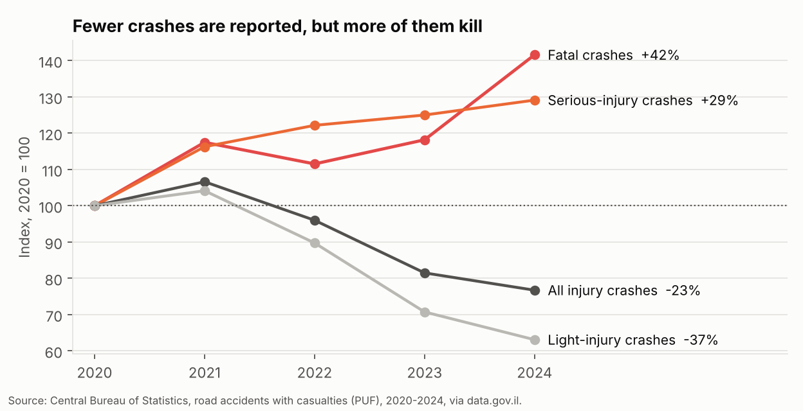
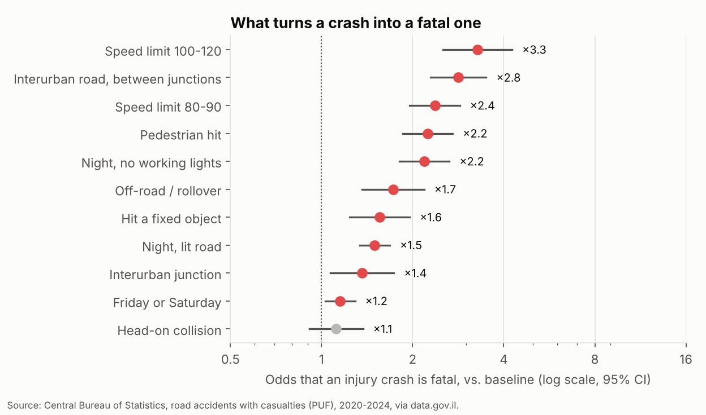
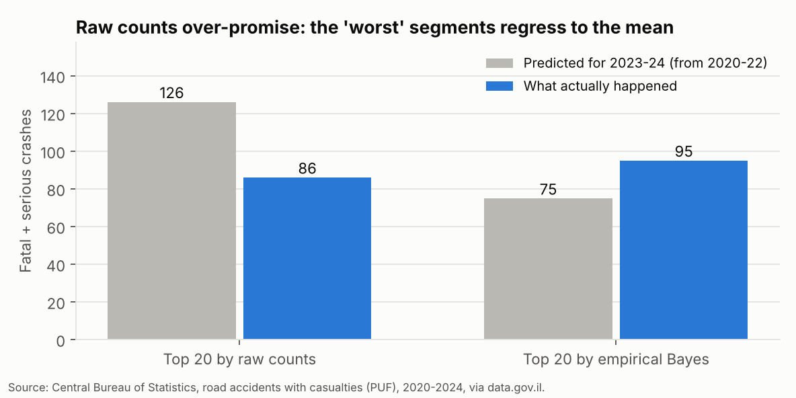
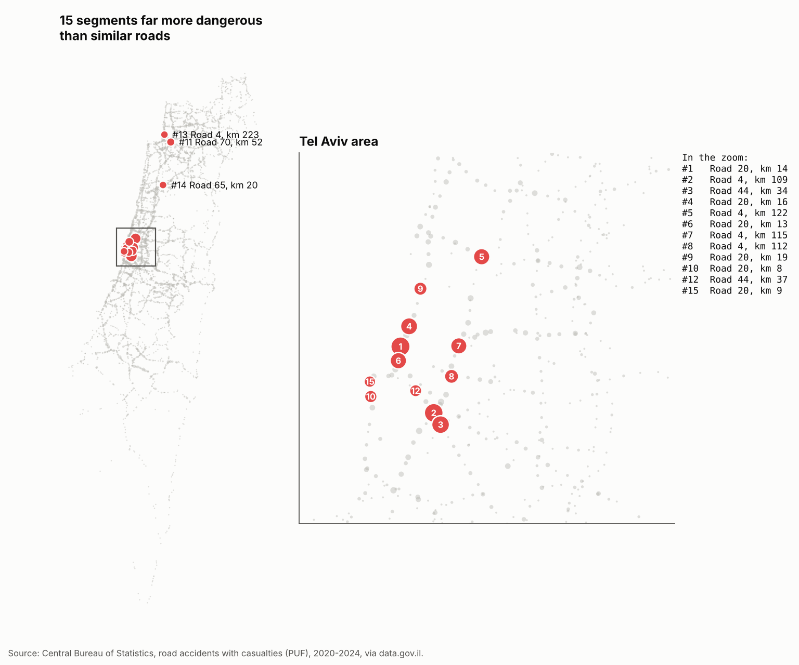
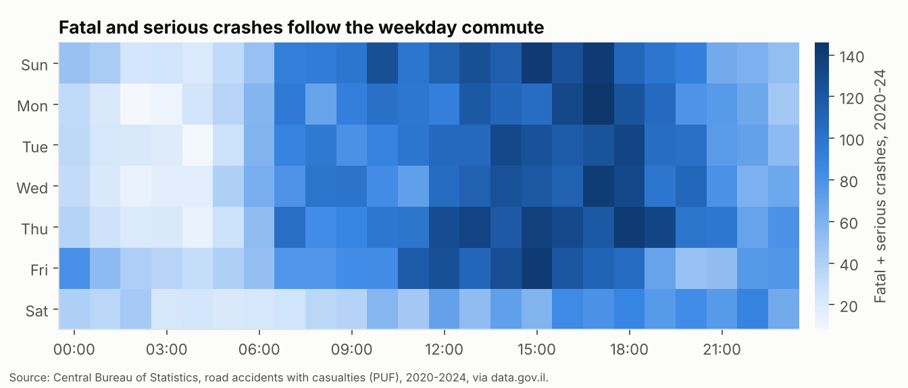

# Fewer crashes reported, more of them deadly: Israel's roads, 2020–2024

**An analysis of all 49,941 police-recorded injury road crashes in Israel, using public data from the Central Bureau of Statistics.**


-2ea44f)

**[→ Open the interactive dashboard](https://yanaybe.github.io/israel-road-safety-analysis/)**

---

## The short version

| Question | Answer |
|---|---|
| **Are the roads getting safer?** | **No, despite what the headline count suggests.** Injury crashes fell 23% from 2020 to 2024, but **fatal crashes rose 42%** and serious ones 29%. The fall is driven by light-injury crashes, which depend on police reporting. Fatal crashes are recorded almost without fail, so they are the series to trust. |
| **Where did the extra deaths come from?** | **91% of the rise was on interurban roads.** Fatal pedestrian crashes outside cities nearly tripled (13 → 36). |
| **What makes a crash deadly?** | Speed limits of 100–120 (×3.3 odds), interurban road between junctions (×2.8), and night without working lights (×2.2). A pedestrian hit at night on a lit city street dies 8% of the time; on an unlit 80–90 km/h interurban road, **39%**. |
| **Where should money go?** | Ranking road segments by raw crash counts **over-promises by 47%** (regression to the mean). An empirical-Bayes ranking that corrects for traffic and luck picked segments with **10% more actual serious crashes** in the following two years. |
| **Decision** | Track fatal and serious crashes, not total crashes. Target lighting and pedestrian crossings on interurban roads. Choose engineering sites by *excess* risk over similar roads, validated on held-out years. |

<p align="center"></p>

---

## What this project shows

| Skill | Where |
|---|---|
| Messy real-world government data: Hebrew codebooks, 15-minute time codes, a grid coordinate system, corrupt values | [Data](#the-data) |
| Telling a measurement artefact from a real change | [Q1](#q1-are-the-roads-getting-safer) |
| SQL on 50k records: decomposition, time patterns, spatial segmentation | [`sql/`](sql) |
| Interpretable modelling: logistic regression, odds ratios, a validation split by year | [Q2](#q2-what-turns-a-crash-into-a-fatal-one) |
| Avoiding a classic analyst trap: regression to the mean in "top 10" lists | [Q3](#q3-where-should-the-money-go) |
| Proving a method on data it never saw | [Q3](#q3-where-should-the-money-go), [`tests/`](tests) |
| An interactive dashboard a non-analyst can use | [Dashboard](https://yanaybe.github.io/israel-road-safety-analysis/) |
| Reproducibility: pinned environment, CI re-runs everything and checks every committed number | [workflow](.github/workflows/reproduce.yml) |

---

## The data

**Source:** Central Bureau of Statistics (CBS), *Road accidents with casualties, Public Use File*, 2020–2024,
[data.gov.il/dataset/2023-puf](https://data.gov.il/dataset/2023-puf), open licence. One row per
police-recorded crash with at least one casualty: 49,941 crashes and 46 fields. It is de-identified
by design (a "public use file"), with no names, ID numbers or plates.

[`scripts/download_data.py`](scripts/download_data.py) fetches it through data.gov.il's API. The
file host blocks scripted downloads, so the script pages through the datastore instead.
`data/raw/` is committed so CI doesn't depend on the site.

### Data issues and how I handled them

| Issue | What I did |
|---|---|
| **The codebook is a single Hebrew column** (`table,code,label` joined with commas, labels containing commas and quotes) | Parsed it in SQL into a lookup table ([`00_load.sql`](sql/00_load.sql)). A test checks every code used has a label. |
| **Time is a 15-minute slot (1–96)**, not an hour | Converted to hour of day: `(slot - 1) // 4`. |
| **Location uses the Israeli Transverse Mercator grid**, not latitude/longitude | Projected EPSG:2039 → WGS84 with `pyproj`. |
| **Road kilometre markers are in units of 100 m**, and 36 are negative | Grouped into 1-km segments; negative markers are excluded and a test enforces it. |
| **One coordinate converts to infinity** | Kept only points inside Israel's bounding box. Found because the dashboard map broke. |
| **"Unknown" isn't random.** Crashes with an unknown speed limit are 65% fatal or serious, against 21% when known. Unknown lighting: 49% vs 21%. | Kept "unknown" as its own category in every model instead of dropping those rows, which would have biased the results. |
| **Scope differs between published figures** (with or without Judea & Samaria) | Reported both. Reconciled with the Road Safety Authority's published fatal-crash counts (2021: 303 vs 304 published; 2023: 338 vs 336) in a [test](tests/test_data_quality.py). |
| **No traffic volume per road segment** in public data | Used light-injury crashes as a stand-in for exposure (see Q3) and listed it as the main limitation. |

## Findings

All numbers come from [`analysis/findings.md`](analysis/findings.md), which the analysis script
regenerates. CI fails if the committed numbers don't match a fresh run.

### Q1. Are the roads getting safer?

| Year | Injury crashes | Fatal | Serious | Light | Fatal or serious |
|---|---|---|---|---|---|
| 2020 | 10,836 | 286 | 1,899 | 8,651 | 20.2% |
| 2021 | 11,554 | 336 | 2,208 | 9,010 | 22.0% |
| 2022 | 10,404 | 319 | 2,320 | 7,765 | 25.4% |
| 2023 | 8,832 | 338 | 2,374 | 6,120 | 30.7% |
| 2024 | 8,315 | 405 | 2,452 | 5,458 | 34.4% |

- If you only read the total, roads look 23% safer.
- But the total is dominated by **light** crashes (80% of records in 2020), and those depend on
  police attending and filing. **Fatal crashes are almost never missed**, and they rose 42% (+47%
  excluding Judea & Samaria). Serious crashes rose too.
- This data can't say how much of the light-crash decline is real and how much is reporting. It
  can say the trend in deaths is unambiguous, and it matches the [record 439 road deaths reported for 2024](https://www.tribuneindia.com/news/world/after-record-number-of-road-fatalities-israel-to-hold-national-emergency-conference).
- **Where:** 91% of the increase in fatal crashes was on interurban roads. The largest growth is in
  front-to-side collisions (21 → 54) and pedestrians hit outside cities (13 → 36).

**→ So what:** a dashboard showing "total crashes" tells the wrong story. The headline KPI should be fatal + serious crashes.

### Q2. What turns a crash into a fatal one?

<p align="center"></p>

A logistic regression of *crash is fatal* on road type, speed limit, lighting, crash type, weekday
and year, over all 49,941 crashes. Each year was held out in turn and predicted by a model that never
saw it, which gives a **cross-validated AUC of 0.76**.

- **Speed is the biggest single factor:** a 100–120 km/h limit triples the odds a crash is fatal
  (×3.3, 95% CI 2.5–4.3) compared with a ≤ 50 km/h street.
- **Darkness without lights doubles them** (×2.2). Lit roads at night: ×1.5.
- **Pedestrians:** ×2.2. Combined, the model puts the death rate for a pedestrian hit at night at
  **8% on a lit city street and 39% on an unlit 80–90 km/h interurban road**.
- Reading note: odds are *conditional on a crash being recorded*. If light crashes are increasingly
  unrecorded, the year terms absorb that shift, so the other estimates are not distorted by it.

### Q3. Where should the money go?

<p align="center"></p>

The usual approach is to list the road segments with the most serious crashes and fix those. The
problem: with 3,899 segments, some have bad years by chance, and next year they look better without
any intervention (**regression to the mean**). A list built that way over-promises, and money goes to
segments that were never unusually dangerous.

**What I did:**

1. Split time: **select** segments on 2020–22, **evaluate** on 2023–24.
2. Compared two rankings:
   - **Raw counts:** fatal and serious crashes per 1-km segment.
   - **Empirical Bayes:** a negative-binomial model predicts what a segment of the same road class
     (national / regional / local) and traffic should see, using light-injury crashes as the traffic
     stand-in. Each segment's count is then shrunk toward that expectation according to how
     reliable it is.
3. Applied the same national trend adjustment (×1.20) to both predictions.

| Top 20 segments | Predicted 2023–24 | Actual 2023–24 | Error | Share of best possible |
|---|---|---|---|---|
| Raw counts | 126 | 86 | **+47%** | 64.7% |
| Empirical Bayes | 75 | **95** | −21% | **71.4%** |

The empirical-Bayes list caught **10% more serious crashes** and was far better calibrated. The
same holds for the top 50 (173 vs 164 crashes; −17% vs +51% error). Both results are checked in the
[tests](tests/test_analysis.py).

<p align="center"></p>

**For action, I rank by *excess* risk:** fatal and serious crashes per year above what a segment of the
same class and traffic should see. This follows the Highway Safety Manual's "potential for safety
improvement", and it is the part an engineering fix can remove. The top segments are on Road 20
(Ayalon), Road 4 and Road 44 in the Tel Aviv area, plus Roads 70, 65 and 4 near Haifa. Explore all
of them in the [dashboard](https://yanaybe.github.io/israel-road-safety-analysis/).

### Q4. When?

<p align="center"></p>

- **Volume follows the commute:** most fatal and serious crashes happen on weekday afternoons.
- **Severity follows the dark:** a crash between 00:00 and 06:00 is fatal 6.9% of the time, against 2.7%
  between 08:00 and 18:00. Saturday crashes are the deadliest (4.5%).

**→ So what:** enforcement aimed at *number* of crashes belongs at rush hour. Enforcement aimed at
*deaths* belongs on interurban roads at night and on weekends.

## Recommendations

| # | Recommendation | Evidence |
|---|---|---|
| 1 | **Report fatal + serious crashes as the headline KPI,** not total crashes | Total fell 23% while deaths rose 42% |
| 2 | **Prioritise interurban lighting and pedestrian crossings** | 91% of the fatal increase was interurban; an unlit 80–90 road is the deadliest place to be hit |
| 3 | **Choose engineering sites by excess risk, re-validated each year** on held-out data | Raw "worst segments" lists over-promise by ~50% |
| 4 | **Night and weekend enforcement on interurban roads** | Night crashes are 2.6× as likely to be fatal |
| 5 | **Publish traffic counts per segment** alongside crash data | The main gap: light crashes are only a stand-in for traffic |

## Limitations

- **Police-recorded crashes only.** Light injuries are under-recorded, and the recording rate may change over time.
- **No traffic volumes.** Light-injury crashes approximate exposure. A segment with many minor
  crashes may get a high expected count and so a smaller *excess*.
- **Associations, not causes.** For example, high speed limits are set on roads that also differ in
  other ways. The model controls for road type, but not for everything.
- 2023–24 includes the war period, which changed traffic patterns in ways this data doesn't capture.

## Reproduce

```bash
pip install -r requirements.txt
python analysis/run_analysis.py      # SQL → models → figures → findings.md → dashboard  (~20 s)
python -m pytest -q                  # 14 tests: data checks, official reconciliation, claims
python scripts/download_data.py      # optional: re-download from data.gov.il
```

## Repository map

```
sql/          load + 5 analysis queries (DuckDB)
analysis/     run_analysis.py · findings.md · results.json · aggregates/
dashboard/    template.html (source) · dashboard.html (built)
docs/         index.html, the dashboard (CI publishes it to the gh-pages branch → GitHub Pages)
figures/      charts above
tests/        data quality, reconciliation with official figures, headline claims
data/raw/     CBS files as downloaded (open licence)
scripts/      download_data.py
```

Code: MIT licence. Data: © Central Bureau of Statistics, published on data.gov.il under an open licence.
